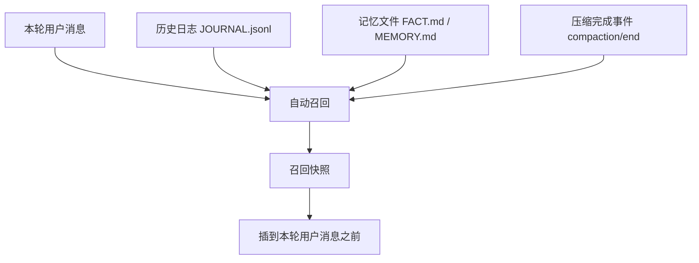
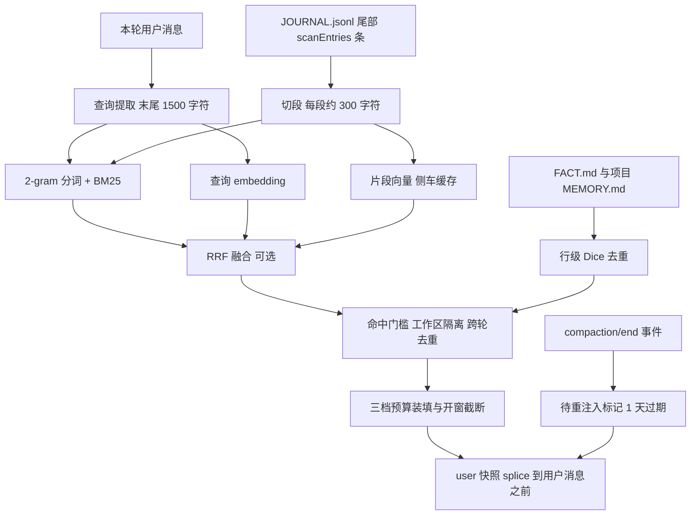

# 日志自动召回（persona-memory-recall）

[](LICENSE)

主插件 [dsh-persona-memory](https://github.com/hu568/dsh-plugin-persona-memory) 的读侧附属插件：每轮把本轮用户消息当查询，从本地 `JOURNAL.jsonl` 自动召回相关历史片段，作为一条 user 快照插到本轮用户消息之前；可选叠加 bge-m3 语义通道补同义改写漏杀。

| 状态 | 信息 |
| --- | --- |
| 最新版本 | [0.6.0](https://github.com/hu568/dsh-plugin-persona-memory-recall/releases) |
| 平台 | DSH 宿主组合（桌面端与 Web 会话通用；子代理默认不注入） |
| 技术栈 | 纯 ESM JavaScript · Cordis 插件 · DSH 宿主 API（`agent/pre-step`、`session/event`、`personaMemory.settings`）· 无构建步骤 |
| 核心引擎 | 2-gram 分词 + BM25 + 时间衰减；可选 bge-m3 embedding 语义通道与 RRF 融合 |
| 运行依赖 | 只读本地 `JOURNAL.jsonl` 与记忆文件；语义通道可选，需硅基流动 API Key（没 key 不生效） |

---

## ✨ 功能总览

- **每轮自动召回**：不用模型自己想起来去查，每轮自动从长期日志里捞相关片段，只占一个小预算。
- **插在用户消息之前**：命中片段渲染成一条 user 快照，模型最后读到的是本轮意图，而不是工程日志的语体。
- **有门槛、会去重**：常见词命中不算证据；同轮工具循环不重复注入，换措辞再次命中同一段也不重注；按工作区隔离。
- **语义通道可选**：补同义改写的漏杀；没 key、超时、5xx、坏缓存一律退回纯本地关键词检索，不阻塞本轮。不参与语义的轮次输出与 0.5.0 逐字节一致。
- **压缩后重注入**：成功压缩后，下一个有真人消息的轮次把本会话最近日志重建为一条快照。
- **护栏与安全**：三档字符预算、与 `FACT.md` / `MEMORY.md` 去重、二次脱敏；语义通道只发本轮用户消息与候选片段正文。

---

## ⚙️下载与安装

通过插件管理器（创造模式）或命令行安装：

```powershell
# 插件管理器（创造模式）：
#   plugin_manager action=install_bundle target="github:hu568/dsh-plugin-persona-memory-recall"

# 命令行：
dsh plugin --profile <profile> add github:hu568/dsh-plugin-persona-memory-recall

# 卸载（不删除日志，也不影响父插件）
dsh plugin --profile <profile> remove @dsh-external/dsh-persona-memory-recall
```

装包会追加进 profile 的 `dsh.profile.bundles`，其 `cordis.patch.yml` 把 `persona-memory-recall` 一行插进宿主组合；**装包本身不用重启**，但改 `lib/*.js` 必须重启（DSH 不监听 `node_modules`，ESM 有加载缓存）。pnpm 报的 `cordis` peer 缺失可忽略，运行时不解析它。

---

## 🧱 架构



---

# 🛠️对开发者

## 🚀 快速开始

### 环境要求

- DSH 宿主：peer 为 `cordis >=4.0.0-rc <5`；父插件 `@dsh-external/dsh-persona-memory`（建议 ≥0.10.0，本插件只读它的 `JOURNAL.jsonl`，不 import 代码）。
- 运行依赖 `schemastery`（别名安装 `npm:@deepseek-ai/schemastery@3.18.2`）。
- 不需要 Harness 源码与构建工具；语义通道可选，需要硅基流动 API Key。

### 构建

无构建步骤：`lib/*.js` 就是源码（纯 ESM），宿主直接加载。

### 安装 / 运行

```powershell
# 安装（与上文相同）
dsh plugin --profile <profile> add github:hu568/dsh-plugin-persona-memory-recall

# 改源码后必须重启 DSH，或 remove 再 add 重装
dsh plugin --profile <profile> remove @dsh-external/dsh-persona-memory-recall
dsh plugin --profile <profile> add github:hu568/dsh-plugin-persona-memory-recall
```

### 首次配置

1. 先装父插件产生日志；单独装本插件也可以，只要 `$DSH_HOME/memory/JOURNAL.jsonl` 存在。
2. 打开「设置 → 记忆 → 自动召回」：主开关、高级参数、语义分组；覆盖层写 `$DSH_HOME/memory/recall.json`，语义 key 单独原子写 `$DSH_HOME/memory/recall-rag.json`。
3. 验证：发一条能命中历史日志的问题，下一轮应出现 `<recalled-journal hits="n">` 块；`debug: true` 会把每次注入 / 跳过的原因写进宿主日志。

> 安全说明：语义通道会把本轮用户消息与候选片段正文发给硅基流动 `/embeddings` 接口；不能接受就关掉，纯 BM25 完全本地。API Key 只落 `recall-rag.json`（原子写 + `chmod 600`），不进覆盖层、不进 git，日志与错误信息里不出现。

#### 配置项与默认值

| 字段 | 默认 | 说明 |
| --- | --- | --- |
| `enabled` | `true` | 总开关 |
| `topK` | `5` | 最多注入几段 |
| `maxTotalChars` / `maxEntryChars` / `minEntryChars` | `600` / `240` / `40` | 整轮总额（含前言与标签）、单条上限、最小条 |
| `chunkChars` / `maxChunksPerEntry` | `300` / `12` | 建索引时单段目标长度、每条日志最多切几段 |
| `scanEntries` | `500` | 只索引日志尾部 N 条 |
| `minScore` / `relativeCut` | `1.0` / `0.35` | BM25 绝对分门槛、相对最高分的截断比例 |
| `recencyHalfLifeDays` / `recencyWeight` | `30` / `0.15` | 时间衰减半衰期与最大加成 |
| `minTurnsBetween` / `subagent` | `0` / `false` | 两次注入最小间隔、子代理是否也召回 |
| `dedupeAgainstMemory` / `dedupeDiceThreshold` | `true` / `0.7` | 与记忆文件去重、行级 Dice 阈值 |
| `workspaceIsolation` | `true` | 按 `cwd` / `workspaceId` 隔离，无字段旧行放行 |
| `rehydrate` / `maxRehydrateEntries` / `maxRehydrateChars` | `true` / `12` / `1200` | 压缩后重建注入 |
| `semantic` | `true` | 语义召回总开关；没 key 时不生效 |
| `semanticModel` / `semanticBaseURL` | `BAAI/bge-m3` / `https://api.siliconflow.cn/v1` | 嵌入模型与接口地址 |
| `semanticMinSimilarity` / `semanticTimeoutMs` | `0.55` / `4000` | cosine 门槛、单轮语义查询超时 |
| `semanticCachePath` / `semanticWarmupBatch` | 空 / `64` | 向量缓存侧车路径、每轮后台补多少条 |

兼容规则：新键 > 0 优先，为 0 或没写时回落到旧键（`maxTotalChars → maxChars`、`maxEntryChars → perChunkChars`）；`0` 是「没设过」的哨兵，不是「关掉预算」。

#### 数据落点

| 路径 | 用途 |
| --- | --- |
| `$DSH_HOME/memory/JOURNAL.jsonl` | 只读，召回的唯一数据源（尾部 `scanEntries` 条） |
| `$DSH_HOME/memory/recall.json` | 设置页覆盖层，只存显式改过的键 |
| `$DSH_HOME/memory/recall-rag.json` | 语义通道 API Key（`chmod 600`，不进覆盖层） |
| `$DSH_HOME/memory/recall/embeddings.json` | 向量缓存侧车（可丢弃可重建，约 2.7 KB/段） |
| `$DSH_HOME/memory/recall/pending-rehydrate.json` | 压缩后待重注入标记（超过 1 天启动时清掉） |

---

## 🔧 进阶：改源码与跑测试

改的是 `lib/*.js`：DSH 不监听已装包的 `node_modules`，且 ESM 有加载缓存。装包（`dsh plugin add`）能经 HMR 重载该层，但**改源码必须重启 DSH，或 remove 再 add 重装**。

### 跑测试

```bash
# 一条命令跑全量（逐个跑 test/*.test.mjs；等价入口 npm test）
node test/run-all.mjs

# 单独跑
node test/recall-budget.test.mjs

# 语义召回在线对比：opt-in，需要 SILICONFLOW_API_KEY，没有 key 直接 skip
node test/rag-eval.test.mjs
```

`run-all.mjs` 全程离线（`rag-eval.test.mjs` 是唯一会联网的用例，没 key 时打印提示并 skip）；开跑前 `test/ensure-deps.mjs` 自动补齐 `schemastery` 与宿主包链接。

### 已知边界与坑

- **注入会累积到下一次 compaction**：宿主 `agent/pre-step` 注入的固有代价，护栏只能减少次数与体积。
- **语义通道是可选增量，不是向量库**：没有 key 就是纯 BM25；同义改写靠向量补漏，不保证每次都比 BM25 好。
- **语义通道依赖外部接口**：免费配额与网络都可能出问题，失败一律降级；正文片段会离开本机。
- **只看日志尾部**：默认 500 条，更旧的笔记要用 `memory action=search`。
- **查询就是本轮用户消息**：不做 LLM query rewrite，不为召回再花一次模型调用。
- **中文按 2-gram**：召回率优先，偶尔有噪声命中，靠 `relativeCut` 与预算兜底。
- **重注入依赖宿主事件**：只认成功的 `compaction/end`；标记只活 1 天。
- **跨轮去重只在内存**：引擎重启后清空。
- **不生成记忆**：本插件只读日志，自动沉淀是另一个插件的事。

---

## 🧱 总架构图



---

## 📁 仓库结构

```
dsh-plugin-persona-memory-recall/
├── README.md / docs/CHANGELOG.md   # 📖 本文件 / 历史变更
├── LICENSE / package.json
├── cordis.patch.yml                # 宿主组合补丁
├── lib/                            # 宿主半源码，纯 ESM、无构建
│   ├── index.js                    # 入口：Config、pre-step 监听、压缩事件、会话态
│   ├── journal.js / chunk.js / tokenize.js / bm25.js   # 日志读取、切段、分词、打分
│   ├── semantic.js / fuse.js       # embedding 客户端与缓存、RRF 融合
│   ├── recall.js / workspace.js / dedupe.js / hash.js  # 门槛、隔离、去重、指纹
│   ├── memory.js / redact.js       # 读记忆文件、二次脱敏
│   ├── compaction-watch.js / rehydrate.js              # 压缩事件与重注入
│   ├── settings.js                 # 设置页项与覆盖层
│   └── types/index.d.ts
└── test/                           # 回归测试（run-all.mjs + *.test.mjs）
```

---

## 📚 文档索引

| 文档 | 内容 |
| --- | --- |
| [docs/CHANGELOG.md](docs/CHANGELOG.md) | 历史变更记录 |
| [LICENSE](LICENSE) | MIT 许可证全文 |
| [package.json](package.json) | 版本、peerDependencies 与依赖 |
| [cordis.patch.yml](cordis.patch.yml) | 宿主组合补丁 |
| [test/run-all.mjs](test/run-all.mjs) | 跨平台测试入口 |
| [主插件 dsh-persona-memory](https://github.com/hu568/dsh-plugin-persona-memory) | 记忆文件格式、`JOURNAL.jsonl` 写入契约、设置页扩展点 |

---

## 🗺️ 路线图

1. **召回质量（持续收敛）**：命中门槛、topK 分档、行级去重与开窗截断继续按真实语料调口径；离线评测只防退化，不当作线上指标。
2. **语义通道（可选增量）**：维持「只补漏、不替换 BM25」的定位；继续用侧车缓存而不是向量库，失败一律降级。
3. **暂不做**：不引 FAISS / HNSW 等向量库与常驻服务（语料是单文件尾部几百条，收益为零）；不做 LLM query rewrite（不为召回多花一次模型调用）。

---

## 📄 许可证

本项目基于 [MIT License](LICENSE) 发布。

- 软件按「现状」提供，不附带任何明示或暗示担保；语义通道的调用费用与数据外发责任由使用者承担。
- 第三方归属：宿主 peer 包 `cordis`、父插件 `@dsh-external/dsh-persona-memory` 与依赖 `schemastery` 的许可归属以各自仓库或包为准；`BAAI/bge-m3` 由硅基流动提供，受其服务条款约束。